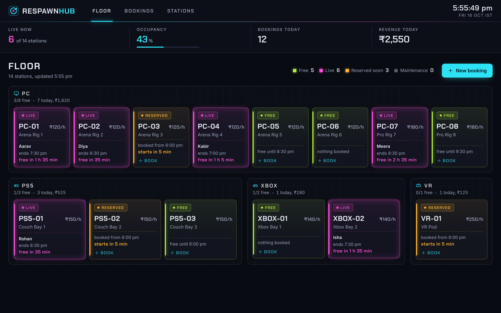
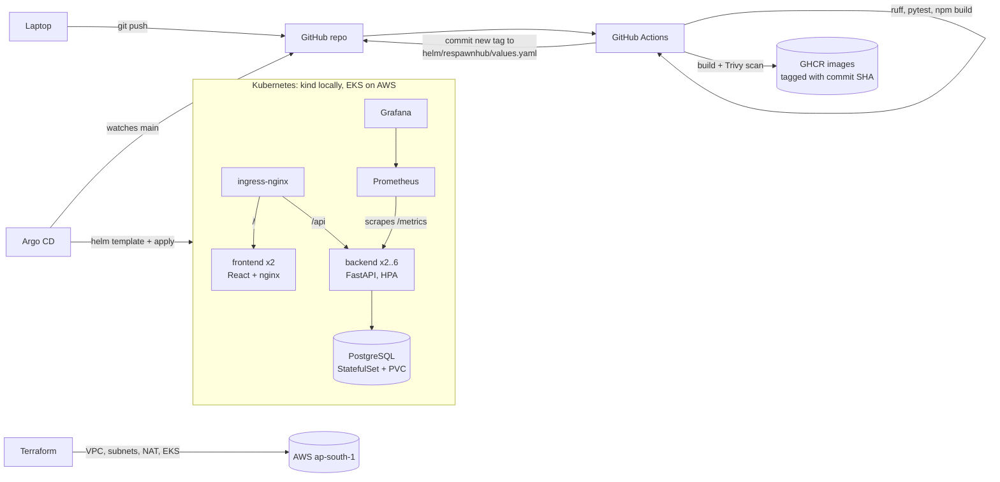

# RespawnHub

RespawnHub is a booking app for a gaming cafe. Staff see the whole floor at a glance (which PCs, PS5s, Xboxes and the VR pod are free, in use or about to be booked), book a station for a player, and the app refuses double bookings. Behind it is the full path from a commit on my laptop to a monitored Kubernetes cluster on AWS.



Demo video:

https://github.com/user-attachments/assets/567eae15-d0e0-4a18-8476-38c3893fe036

If the player does not load, download [demo-video.mp4](demo-video.mp4).

## What it does

- **Live floor:** every station as a tile, coloured by state (free, live, reserved soon, under maintenance), with countdowns. Refreshes every 15 seconds.
- **Bookings:** 30 minute slots, up to 8 hours, priced from the station's hourly rate. Overlapping bookings on the same station are rejected with a clear message (HTTP 409), back to back bookings are fine. Cancel, restore, delete.
- **Stations:** add, edit, mark under maintenance, remove (only if it has no bookings).
- **Today's numbers:** stations live now, occupancy, bookings and revenue for the day (cafe time, Asia/Kolkata).

## Architecture



| Layer | Tool | Why this one |
|---|---|---|
| Frontend | React 19 + Vite, served by nginx (unprivileged) | Static build, tiny runtime image, nginx also proxies `/api` in Compose |
| Backend | FastAPI, SQLAlchemy 2, Alembic | Typed request validation, auto Swagger docs at `/docs`, versioned schema migrations |
| Database | PostgreSQL 16 | Real row locking for the booking check (`SELECT ... FOR UPDATE`) |
| Tests | pytest on in-memory SQLite, ruff | Fast, never touches the real database |
| Containers | Docker, Docker Compose | One command to run the whole stack locally |
| CI/CD | GitHub Actions | Lives next to the code; free for public repos |
| Security | Trivy | Fails the build on fixable HIGH or CRITICAL CVEs, plus a secret scan of the repo |
| Registry | GitHub Container Registry | Same account as the repo, images built for amd64 and arm64 |
| Infrastructure | Terraform (AWS VPC and EKS modules) | The whole AWS setup is code: reviewable, repeatable, and `terraform destroy` removes it |
| Orchestration | Kubernetes, Helm, Argo CD | Helm packages the app once for every environment; Argo CD keeps the cluster equal to Git |
| Scaling | HorizontalPodAutoscaler + metrics-server | Backend goes from 2 to 6 pods on CPU |
| Monitoring | Prometheus + Grafana (kube-prometheus-stack) | HTTP metrics plus business metrics (bookings, conflicts, live stations) |

Why Kubernetes and not just Compose on a VM, or ECS? Compose has no self healing across machines and no autoscaling. ECS would work on AWS, but the same Helm chart here runs unchanged on a laptop (kind) and on EKS, and the GitOps flow with Argo CD is the same in both places.

## Repository layout

```text
backend/          FastAPI app, Alembic migrations, pytest tests, Dockerfile
frontend/         React app, nginx config template, Dockerfile
docker-compose.yml
.github/workflows/ci-cd.yml
helm/respawnhub/  Helm chart (values for kind, EKS and a staging release)
k8s/              namespace, kind cluster config, ingress-nginx values, load test Job
argocd/           Argo CD install values and Application manifests
monitoring/       kube-prometheus-stack and metrics-server values
terraform/        AWS VPC + EKS
troubleshooting/  broken manifests and the runbook for fixing them
scripts/          cluster setup, demo data
docs/screenshots/ evidence for everything below
```

## Run it locally

Needs Docker.

```bash
docker compose up --build -d
```

- App: http://localhost:3000
- API docs: http://localhost:8000/docs
- Health: http://localhost:8000/health, readiness: http://localhost:8000/ready, metrics: http://localhost:8000/metrics

Add some realistic bookings for today: `python3 scripts/seed_demo.py http://localhost:3000`

The backend waits for Postgres to pass its healthcheck before starting (`depends_on: condition: service_healthy`), then runs `alembic upgrade head` and starts Uvicorn. Stop with `docker compose down` (add `-v` to wipe the database).

## API

| Method | Path | What it does |
|---|---|---|
| GET | `/health` | Liveness, no database call |
| GET | `/ready` | Readiness, checks the database |
| GET | `/metrics` | Prometheus metrics |
| GET, POST | `/api/stations` | List (filter by type or active) and create stations |
| GET, PUT, DELETE | `/api/stations/{id}` | Read, update, delete (409 if it has bookings) |
| GET, POST | `/api/bookings` | List (filter by day, station, status) and create (409 on overlap) |
| GET, PUT, DELETE | `/api/bookings/{id}` | Read, reschedule or cancel, delete |
| GET | `/api/floor` | Every station with its live state |
| GET | `/api/stats` | Today's bookings, revenue, occupancy |
| GET | `/api/meta` | Running build, shown in the top bar |

## Tests

```bash
cd backend
python3.12 -m venv .venv && source .venv/bin/activate
pip install -r requirements-dev.txt
ruff check . && pytest -v
```

47 tests: the booking rules on their own (slot length, half hour starts, overlaps, pricing, floor state, cafe day boundaries) and every endpoint through FastAPI's test client against in-memory SQLite, with the clock frozen so time based rules are repeatable.

## CI/CD

`.github/workflows/ci-cd.yml` runs on every push and pull request to `main` (pushes that only touch docs, Markdown or the slides are skipped):

1. **Test and lint:** ruff, pytest, `npm ci && npm run build`. Anything failing stops the pipeline, so a broken build never becomes an image.
2. **Helm, Terraform and secret checks:** `helm lint`, `terraform fmt -check` and `validate`, Trivy secret scan of the repo.
3. **Build, scan and push** (backend and frontend in parallel): build, Trivy image scan that fails on fixable HIGH or CRITICAL CVEs, then push a multi-arch image tagged with the full commit SHA to GHCR. Pull requests build and scan but do not push.
4. **Update the deployed version:** writes the new SHA into `helm/respawnhub/values.yaml` and commits it as `Deploy <sha>`. That commit is what Argo CD deploys.

Every image tag is a commit SHA, so any running pod can be traced back to the exact commit. All third party actions are pinned to commit SHAs.

The first Trivy run failed the frontend image: the `nginx-unprivileged` base shipped Alpine packages with 43 fixable HIGH CVEs (curl, OpenSSL, expat and others). The Dockerfile now runs `apk upgrade` and removes curl, and the scan is clean. Screenshots: [before](docs/screenshots/10-trivy-before-fix.png), [after](docs/screenshots/11-trivy-after.png).

## Kubernetes on kind

Needs Docker, kind, kubectl and Helm.

```bash
./scripts/kind-up.sh
```

This creates a 3 node kind cluster and installs ingress-nginx, metrics-server, Prometheus + Grafana and Argo CD, creates the database Secret with a random password, and registers the app with Argo CD. Argo CD then deploys the Helm chart from this repo.

- App: http://respawnhub.localhost (no hosts file needed, `*.localhost` resolves to this machine)
- Grafana: `kubectl -n monitoring port-forward svc/monitoring-grafana 3001:80`
- Argo CD: `kubectl -n argocd port-forward svc/argocd-server 8081:80`

What the chart deploys:

- backend Deployment (2 replicas, init container waits for Postgres, readiness on `/ready`, liveness on `/health`, non-root with a read-only root filesystem)
- frontend Deployment (2 replicas)
- ClusterIP Services
- Postgres StatefulSet with a PersistentVolumeClaim
- Ingress (`/api` and `/docs` to the backend, `/` to the frontend)
- HPA (2 to 6 backend pods at 60% CPU)
- ServiceMonitor
- Grafana dashboard ConfigMap

The database password comes from a Secret created outside Git.

A second copy runs as a plain Helm release to show install, upgrade, history and rollback:

```bash
kubectl create namespace respawnhub-staging
kubectl -n respawnhub-staging create secret generic respawnhub-db --from-literal=password=$(openssl rand -hex 16)
helm upgrade --install respawnhub ./helm/respawnhub -n respawnhub-staging -f helm/respawnhub/values-staging.yaml
helm list -n respawnhub-staging
```

It answers on http://staging.respawnhub.localhost.

### GitOps in practice

Change code, push, and the cluster follows: the pipeline tests, scans and pushes the image, then commits the new tag. Argo CD notices within a minute and rolls the pods. The top bar of the app shows the build it is running, so the new version is visible right away. Anything changed by hand in the cluster is reverted to what Git says (self heal).

### Autoscaling

```bash
kubectl apply -f k8s/load-test-job.yaml
kubectl get hpa -n respawnhub -w
```

The Job runs fortio with 40 concurrent requests against `/api/floor` for four minutes. The HPA takes the backend from 2 to 6 pods. On the first run only the original two pods got any CPU, because fortio kept 40 keep-alive connections open and kube-proxy balances per connection, not per request. With `-keepalive=false` every request opens a new connection and the load spreads over all six pods.

## Monitoring

Prometheus scrapes `/metrics` on every backend pod through the ServiceMonitor. Besides the standard HTTP metrics, the backend exports:

- `respawnhub_bookings_created_total{station_type}`
- `respawnhub_booking_conflicts_total` (double bookings refused)
- `respawnhub_booking_revenue_rupees_total{station_type}`
- `respawnhub_stations_live` (worked out from the database at scrape time)

The Grafana dashboard (shipped in the chart) shows request rate and p95 latency by route, responses by status, the 5xx rate, bookings per hour by station type, conflicts, live stations, CPU per backend pod, and current vs desired pods from the HPA.

## AWS with Terraform

`terraform/` creates, in `ap-south-1`:

- a VPC across two availability zones, with two public and two private subnets
- one NAT gateway
- an EKS 1.36 cluster with a managed node group of `t3.large` workers
- the EBS CSI driver add-on (with Pod Identity), which also makes gp3 the default StorageClass for the Postgres volume

```bash
cd terraform
cp terraform.tfvars.example terraform.tfvars   # set aws_profile
terraform init && terraform plan -out tfplan && terraform apply tfplan
cd .. && ./scripts/eks-up.sh                   # kubeconfig, platform, Argo CD, prints the app URL
./scripts/eks-down.sh                          # deletes the load balancer, then terraform destroy
```

No credentials are stored in the repo; Terraform uses the AWS CLI profile. The same Helm chart and Argo CD setup as kind is used, with `values-eks.yaml` (answers on any hostname, default gp3 storage) and ingress-nginx behind an AWS Network Load Balancer (`k8s/ingress-nginx-eks-values.yaml`). Both scripts read `aws_profile` from `terraform.tfvars`.

What happened on the real run: `terraform apply` created 55 resources in about 12 minutes (the EKS control plane alone took 8.5). `scripts/eks-up.sh` installed the platform, Argo CD deployed the latest build from `main`, Postgres got a gp3 EBS volume, and the app answered through an AWS Network Load Balancer. After the screenshots, `scripts/eks-down.sh` removed the load balancer and the volume and ran `terraform destroy` (55 destroyed). A final check found no cluster, VPC, volume, load balancer, Elastic IP, NAT gateway, instance or log group left. The customer managed KMS key and control plane log group are turned off in `main.tf` because both outlive `terraform destroy` (a KMS key waits at least 7 days before deletion).

## Troubleshooting

[troubleshooting/RUNBOOK.md](troubleshooting/RUNBOOK.md) walks through four failures I caused on purpose and fixed:

- an image tag that does not exist (`ImagePullBackOff`)
- a Service whose selector matches no pods (no endpoints)
- a backend with the wrong database password (`CrashLoopBackOff`)
- the Compose start-up race

## Evidence

| What | Screenshot |
|---|---|
| App: floor, booking form, bookings, stations, phone layout | [floor](docs/screenshots/07-compose-ui-floor.png), [form](docs/screenshots/07-compose-ui-booking-form.png), [bookings](docs/screenshots/07-compose-ui-bookings.png), [stations](docs/screenshots/07-compose-ui-stations.png), [phone](docs/screenshots/07-compose-ui-phone.png) |
| Swagger docs | [08-swagger](docs/screenshots/08-swagger.png) |
| Health, readiness, stats | [03-api-health](docs/screenshots/03-api-health.png) |
| Double booking refused | [09-double-booking](docs/screenshots/09-double-booking.png) |
| Data in Postgres, migration version | [05-database](docs/screenshots/05-database.png) |
| pytest | [01-pytest](docs/screenshots/01-pytest.png) |
| `docker compose up --build` and `ps` | [02-compose-up](docs/screenshots/02-compose-up.png) |
| Images and non-root users | [06-images](docs/screenshots/06-images.png) |
| `/metrics` | [04-metrics](docs/screenshots/04-metrics.png) |
| Trivy before and after the base image fix | [before](docs/screenshots/10-trivy-before-fix.png), [after](docs/screenshots/11-trivy-after.png) |
| Pipeline in progress | [running](docs/screenshots/22-actions-running.png) |
| Kubernetes resources on kind | [15-k8s-resources](docs/screenshots/15-k8s-resources.png) |
| Helm install, upgrade, rollback | [install](docs/screenshots/16-helm-install.png), [upgrade and rollback](docs/screenshots/17-helm-upgrade-rollback.png) |
| Prometheus targets | [18-prometheus-targets](docs/screenshots/18-prometheus-targets.png) |
| Grafana dashboard | [19-grafana-dashboard](docs/screenshots/19-grafana-dashboard.png) |
| HPA scaling | [20-hpa-scaling](docs/screenshots/20-hpa-scaling.png) |
| Troubleshooting | [bad image](docs/screenshots/12-troubleshoot-bad-image.png), [no endpoints](docs/screenshots/13-troubleshoot-service.png), [crash loop](docs/screenshots/14-troubleshoot-crashloop.png) |
| GitOps: commit, bot deploy commit, Argo CD synced, new build in the UI | [git and cluster](docs/screenshots/24-gitops-flow.png), [Argo CD before](docs/screenshots/21-argocd-before.png), [after](docs/screenshots/25-argocd-after.png), [top bar shows the build](docs/screenshots/26-kind-ui-new-build.png) |
| Pipeline runs | [one run, all jobs green](docs/screenshots/27-actions-green.png), [all runs](docs/screenshots/39-actions-runs.png) |
| Images in GHCR, tagged with commit SHAs | [packages](docs/screenshots/38-ghcr-packages.png), [backend versions](docs/screenshots/37-ghcr-backend.png) |
| Commit history | [36-commit-history](docs/screenshots/36-commit-history.png) |
| Terraform plan and apply | [plan](docs/screenshots/23-terraform-plan.png), [apply](docs/screenshots/28-terraform-apply.png) |
| EKS cluster, nodes, PVC on gp3, load balancer | [29-eks-resources](docs/screenshots/29-eks-resources.png), [app on AWS](docs/screenshots/30-eks-app.png) |
| AWS console: EKS, EC2 nodes, VPC, subnets | [EKS](docs/screenshots/31-aws-eks-cluster.png), [EC2](docs/screenshots/32-aws-ec2-nodes.png), [VPC](docs/screenshots/33-aws-vpc.png), [subnets](docs/screenshots/34-aws-subnets.png) |
| `terraform destroy` | [35-terraform-destroy](docs/screenshots/35-terraform-destroy.png) |

## Things that went wrong and what I changed

- **Database restarted on every deploy.** The Postgres pod template carried the app version label, which changes with every commit, so each deploy rolled the StatefulSet. Postgres pods now only carry stable labels.
- **Frontend healthcheck never passed in Compose.** Busybox `wget localhost` tried IPv6 (`::1`) first while nginx listened on IPv4 only. The check now uses `127.0.0.1`.
- **Load test only hit two pods.** Keep-alive connections, see Autoscaling above.
- **The first booking after a deploy never showed in Grafana.** A labelled counter only appears when it is first incremented, so Prometheus first saw it at 1 and `increase()` had nothing to compare against. Every station type is now published at 0 when the app starts.
- **43 HIGH CVEs in the nginx base image.** Fixed with `apk upgrade` in the Dockerfile, see CI/CD above.

## Clean up

```bash
docker compose down -v
./scripts/kind-down.sh
./scripts/eks-down.sh        # only if the AWS cluster is up
```
